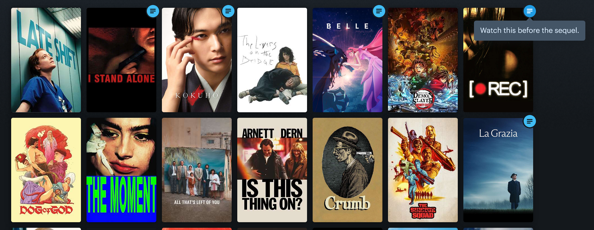
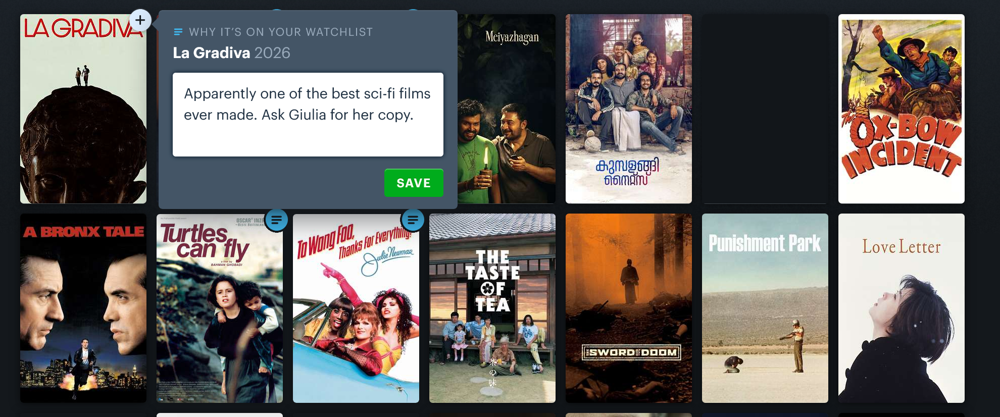
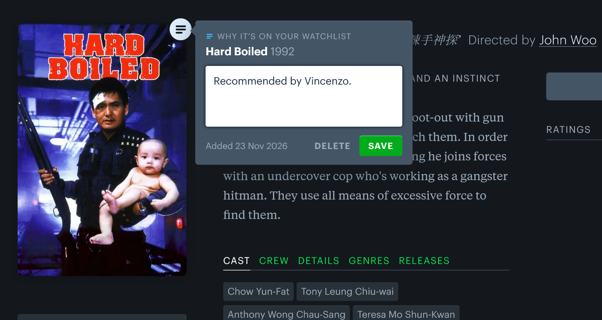
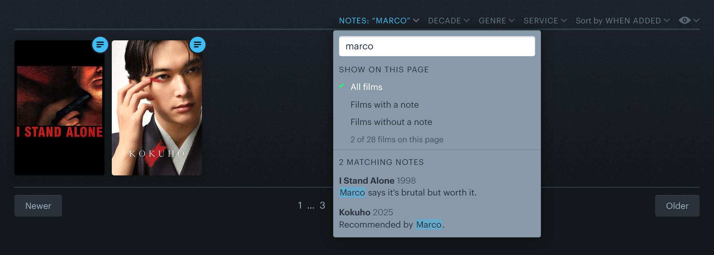

<p align="center">
  
</p>

<h1 align="center">Whylisted</h1>

<p align="center">
  <strong>Remember why it's on your watchlist.</strong><br>
  Private notes for your Letterboxd Watchlist, right on the poster. Synced across your computers with your Firefox account.
</p>

<p align="center">
  
</p>

---

## The problem

Saving a film to your Letterboxd Watchlist takes one click. Remembering *why* you saved it is harder.

You add films for all kinds of reasons:

- a friend told you, twice, that you *have* to see it;
- you read a review that stuck with you;
- you want to see it before the sequel comes out;
- it's part of a director's filmography you're working through;
- you saw thirty seconds of it and loved how it looked.

The reason is obvious when you add the film. Three months and two hundred films later it's gone. You open the Watchlist to pick something for tonight and see a wall of posters, many of which you can't place any more. *Who recommended this? Why did I want to see it?*

Letterboxd doesn't offer a place to write that down. **Whylisted adds one.**

## What it does

Whylisted lets you attach a short private note to any film, and shows it where you need it: on the poster.

<p align="center">
  
</p>

- **See at a glance which films have a note.** They carry a small blue badge in the top-right corner of the poster, set into a cut-out ring the way Letterboxd shows avatars on attributed posters.
- **Read it without clicking.** Hover the badge and the note appears in a Letterboxd-style tooltip.
- **Add one in a second.** Hover any poster, click the **+** that appears in the same corner and type. Nothing else on the page moves.
- **Edit or delete it at any time.** The editor shows when the note was added or last edited.
- **Find it on the film's page too.** The same note sits on the cover when you open the film. You can write it there too, even before the film is on your Watchlist.
- **Search and filter by note.** A **Notes** menu joins Letterboxd's own filters above the Watchlist. Type "Marco" to see only the films Marco recommended, or show only films with (or without) a note.
- **Have it on all your computers.** Signed in to Firefox? Your notes follow your account to every computer where you use Whylisted.

<p align="center">
  
</p>

### Search and filter by note

<p align="center">
  
</p>

The **Notes** menu sits next to Decade, Genre, Service and Sort, and looks like them.

- **Search your notes.** As you type, the grid shows only the films on this page whose note matches. Case and accents don't matter: "marco" finds "Marco". The menu also lists *every* matching note, from any page of your Watchlist or any film page. Click one to open the film.
- **Show films with or without a note.** Handy for finding the films you haven't annotated yet, or only the ones you have.
- **It stays on while you browse.** The search and filter carry over as you page through your Watchlist in that tab. The menu label shows what's active (for example *Notes: "marco"*), and choosing *All films* and clearing the search resets everything.

Letterboxd shows a Watchlist 28 films per page and Whylisted doesn't load the other pages. So the grid filter works on the page you're on, while the list in the menu covers all your notes.

### Designed to look like Letterboxd

Whylisted is meant to look like a feature Letterboxd shipped itself. The editor uses Letterboxd's own dialog colours, its private-note text field, its typography, its green **Save** button and its easing curves. It reads those values from the site's CSS variables, so if Letterboxd changes its look, Whylisted follows.

| | |
|---|---|
| <kbd>Ctrl</kbd>/<kbd>⌘</kbd> + <kbd>Enter</kbd> | Save |
| <kbd>Esc</kbd> | Close without saving |
| Click outside | Save and close, so a note is never lost by accident |
| **Delete** | Asks once ("Delete?"), then removes the note |
| Empty note | Saving an empty note removes it |

The editor keeps keyboard focus inside while it's open, follows `prefers-reduced-motion`, and on narrow screens becomes a full-width panel under the poster.

## Notes follow the film, not the grid

Each note is stored against **Letterboxd's own film identifier** (for example `film:1041139`), which Letterboxd puts on every poster. It is never stored against a position in the grid.

So a note stays with its film when you:

- re-sort or filter the Watchlist, or page through it;
- remove a film and add it back later (the note will be waiting);
- reload the page or restart Firefox;
- open the film's own page (`/film/<slug>/`) or another Watchlist page, or have it open in another tab (tabs stay in sync);
- open your Watchlist on another computer signed in to the same Firefox account.

The film's slug (`/film/la-gradiva/`) is kept as a fallback for the rare poster without an id. If a uid turns up later for a note saved by slug, the note is moved to the uid automatically.

## Sync across devices

Whylisted uses Firefox's own add-on sync. There's no extra account to create.

1. Sign in to your Firefox account on each computer.
2. In **Settings → Sync**, make sure **Add-ons** is ticked.
3. Install Whylisted on each computer.

A note you write at home will be waiting on your laptop. Edits and deletions sync too, and they work offline: Firefox catches up the next time it syncs. If you're not signed in, Whylisted works exactly the same, with notes kept on that computer.

**Firefox for Android.** Whylisted runs on Firefox for Android, but Firefox doesn't sync add-on data to or from Android yet ([Mozilla bug 1625257](https://bugzilla.mozilla.org/show_bug.cgi?id=1625257)). Notes written on your phone stay on your phone, and your desktop notes don't appear there. When Mozilla turns this on, Whylisted will sync on Android with no changes needed.

**How much syncs.** Firefox gives each add-on about 100 KB of synced space (and at most 512 items), which is a few hundred notes of normal length. If you go past that, new notes are still saved, but only on that computer. The editor says *This device only* under the note. Delete a few notes and they move into sync on their own.

## Privacy

- Notes are stored **in your browser**. If you use Firefox Sync, they travel through it, end-to-end encrypted by Firefox, like your bookmarks and passwords. Whylisted has no server, account or tracking of its own and sends nothing anywhere else.
- Whylisted never asks for your Letterboxd credentials and never reads, changes or submits anything on your Letterboxd account.
- Its only permission is `storage`, and it only runs on `letterboxd.com`.

## Install

**From Firefox Add-ons:** coming soon.

**From source (development):** requires Firefox 128 or newer, on desktop or Android. Node.js 22+ is only needed for the tooling.

```bash
git clone https://github.com/dsaldamarco/whylisted.git
cd whylisted
npm install
npm start          # opens a fresh Firefox profile with Whylisted loaded
```

Or load it by hand, without Node:

1. Open `about:debugging#/runtime/this-firefox` in Firefox.
2. Click **Load Temporary Add-on…** and choose `manifest.json` in this folder.
3. Sign in to Letterboxd and open your Watchlist (`letterboxd.com/<you>/watchlist/`).

Temporary add-ons are removed when Firefox closes. Your notes are kept for the next time you load it.

### Scripts

| Command | What it does |
|---|---|
| `npm start` | Run Firefox with the extension loaded (`web-ext run`) |
| `npm run lint` | Validate the extension with Mozilla's linter |
| `npm run build` | Package a `.zip` into `web-ext-artifacts/` |
| `npm run test:e2e` | End-to-end test in real Firefox (see below) |
| `npm run screenshots` | Regenerate the screenshots in this README |
| `npm run icons` | Render `icons/icon.svg` to `docs/logo.png` |
| `npm run sign` | Submit a new version to addons.mozilla.org (needs API keys, see below) |

### Tests

`tests/e2e.mjs` installs the extension into real Firefox (driven by WebDriver BiDi through `puppeteer-core`) and checks the whole lifecycle:

- create, hover preview, edit, cancel and delete;
- notes surviving a reload, a re-sort, grid items re-rendered in place, and a full browser restart on the same profile;
- sync: notes land in Firefox's sync storage, and a note added or deleted "on another computer" (written straight into that storage while Firefox is closed) shows up or disappears; when sync storage is full, notes are kept on the device and move into sync once there's room;
- notes shared between the Watchlist and film pages, with only the film's own cover getting a badge (not the "similar films" row);
- search and filter: matching ignores case and accents, results are highlighted, "with / without a note", the empty state, and the filter carrying over to the next page load;
- the phone-width layout;
- nothing injected on other pages.

Letterboxd shows automated browsers a bot check, so the test does not drive the live site. It fetches the real page HTML with a plain request, strips the scripts, rewrites the posters into the shape they take after Letterboxd's React hydration, and serves the result at the real `letterboxd.com` URL. Class names, data attributes, stylesheets, fonts and poster images are Letterboxd's own.

Set `FIREFOX_PATH` if Firefox isn't in a standard location, and `HEADFUL=1` to watch it run.

## How it works

```
manifest.json            MV3 manifest: one content script bundle + one stylesheet, "storage" permission
icons/icon.svg           the add-on icon
src/
  namespace.js           shared `Whylisted` namespace (nothing leaks into the page)
  film.js                reads the film id, slug, title and year from a poster
  store.js               notes in browser.storage.sync (Firefox Sync), local overflow, migration
  ui/icons.js            inline SVG glyphs
  ui/tooltip.js          Letterboxd-style ("twipsy") tooltip for hints and previews
  ui/editor.js           the note popover: layout, keyboard, save/cancel/delete
  ui/badge.js            the poster badge and its states
  ui/filter.js           the Notes menu: search and filter the Watchlist by note
  main.js                finds posters (Watchlist grid, film-page cover) and keeps badges in sync
  whylisted.css          all styles, built on Letterboxd's own CSS custom properties
tests/                   end-to-end test in Firefox, and the fixture it uses
scripts/                 icon rendering, README screenshots
docs/                    logo and screenshots for this README
```

**Integration.** Letterboxd renders posters as server HTML wrapping React "islands" (`LazyPoster`): `li.griditem` in a Watchlist, `#js-poster-col > section.poster-list.-single` for the cover on a film page. Whylisted only ever appends its badge to that server-rendered wrapper, never inside React's tree, so Letterboxd's re-renders can't remove it and won't trip over it. The cut-out ring is pure CSS (a `mask` on the poster), so React's DOM is never touched.

**Search and filter.** The Notes menu reuses Letterboxd's label markup (`.smenu-wrapper > .smenu > label`), so the uppercase label and chevron are the site's own. The dropdown is Whylisted's, so it doesn't depend on Letterboxd's menu script. Filtering only adds a class that hides grid items, so the page's own markup is left alone. The search and filter are kept in `sessionStorage` for the tab.

**Dynamic pages.** A single `MutationObserver`, batched to one scan per animation frame, picks up posters as they are added, hydrated, re-sorted or swapped in place. Each poster's wrapper remembers which film its badge belongs to. If Letterboxd reuses it for another film, the badge is rebuilt for the new one.

**Styling.** Every class is prefixed `whylisted-`. Colours, fonts and easing come from Letterboxd's CSS custom properties (`--theme-*`, `--font-stack-graphik`, `--timing-function-ease-out-expo`…), with fallbacks set to today's values. The editor opts into Letterboxd's `data-theme="dialog"` palette.

### Storage format

One item per film in `browser.storage.sync`, kept compact because synced space is small:

```json
{
  "n:film:1041139": {
    "t": "Apparently everyone loved this movie.",
    "s": "la-gradiva",
    "n": "La Gradiva",
    "y": "2026",
    "c": 1795428832449,
    "u": 1795428832449
  }
}
```

(`t` text, `s` slug, `n` title, `y` year, `c`/`u` created/updated, in ms.) One item per film means Firefox Sync merges changes from different computers film by film, the most recent edit winning, and `storage.onChanged` says exactly which film changed.

Notes that don't fit in sync live in `browser.storage.local` in a readable form, marked `"local": true`, next to `"schemaVersion": 2`. Version 0.1 kept every note in `storage.local`; those notes move to sync automatically on first run. Export and import can be built on top of either area without a migration.

## Limitations

- **Watchlists and film pages only.** Whylisted runs on `letterboxd.com/<user>/watchlist/…` and on the cover of `letterboxd.com/film/<slug>/…`. It also runs on other people's Watchlists: your notes are about films, so you'll see them on a friend's Watchlist too. Lists, diary and other poster grids aren't covered yet.
- **Sync is Firefox-only and desktop-only for now.** Notes sync between desktop Firefox installs on the same Firefox account. They don't reach Android yet (see [Sync across devices](#sync-across-devices)), or other browsers. Synced space fits a few hundred notes.
- **Uninstalling.** Removing the add-on deletes its notes from that computer. Notes that are still on another synced computer are not affected.
- **Depends on Letterboxd's markup.** Whylisted relies on the film ids Letterboxd puts on posters (`data-postered-identifier`, `data-production-uid`). If those change it fails quietly: no badges, no errors, the page keeps working. An update would then be needed.
- **Phones.** Letterboxd serves the same pages to phones, laid out responsively, and Whylisted's editor becomes a full-width panel on narrow screens. Touch screens have no hover, so they get an always-visible "+". This has been tested at phone width in desktop Firefox, not yet on a real Android device.

## Ideas for later

- Export / import notes (JSON, maybe CSV for spreadsheets)
- Tags ("movie night", "with Marco", "director project")
- Sync on Android, once Firefox supports it
- Notes on lists, diary entries and other poster grids

## Contributing

Issues and pull requests are welcome. Please keep the spirit of the project: one small feature, done carefully, that looks like it belongs on Letterboxd.

## Disclaimer

Whylisted is an independent, unofficial project. It is not affiliated with, endorsed by or sponsored by Letterboxd Limited. "Letterboxd" and the three-dot logo are trademarks of Letterboxd Limited, used here only to show what the add-on works with. Screenshots show Letterboxd's interface and poster artwork from a public Watchlist, for illustration only.

## License

Code: [MIT](LICENSE).
